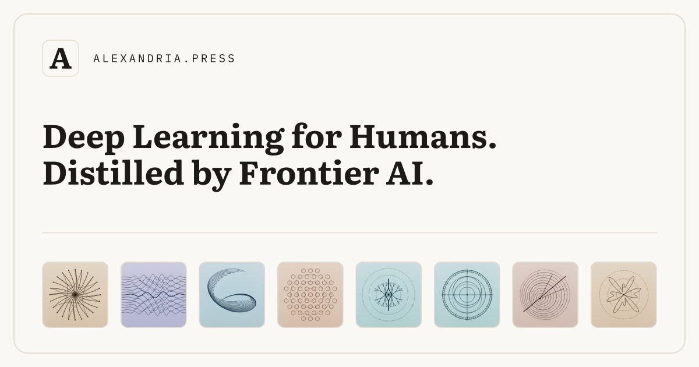

# Alexandria Press

**Deep Learning for Humans. Distilled by Frontier AI.**

[**alexandria.press**](https://www.alexandria.press)



---

## Overview

**Alexandria Press** is a digital library and autonomous publishing engine for concise, high-density illustrated monographs across science, engineering, mathematics, history, philosophy, and human behavior.

Instead of padding one idea into 300 pages of filler, every Alexandria volume is structured as a **12-chapter container** (~8,500 words total):
- **Topic-Only Introduction (~250 words)**: Establishes the core structural thesis or physical constraint without previewing chapters.
- **12 Self-Contained Chapters (~600–650 words each)**: Each chapter unpacks a distinct mechanism, conceptual neighbor, or experimental turning point in a 5-minute read.
- **Primary Provenance Ledger**: Every chapter is anchored in a verified historical record, physical experiment, or primary source (`historical_anchor`) and closes directly on a concrete quantitative or empirical finding (`exit_fact`).
- **Earned Formalisms**: Volumes integrate genuine mathematical equations, theme-aware schematic SVG diagrams (`FIG. N.1`), and structured comparative ledgers—with zero decorative "math cosplay" or fabricated direct quotations.

---

## Four Volume Formats

1. **12-Facet Mechanisms (`mode: "mechanisms"`)**: Examines a complex phenomenon or class of systems from twelve independent physical, mathematical, or historical angles (e.g., *Latent Fragility*, *Planetary Triggers*, *Paper Panics*, *Materials*).
2. **Conceptual Landscapes (`mode: "landscape"`)**: Maps a foundational concept in Chapter 1 and explores eleven neighboring concepts across building blocks, mechanisms, contrasts, cases, and consequences in Chapters 2–12 (e.g., *Entropy*, *Quantum Mechanics*, *Artificial Intelligence*, *Consciousness*).
3. **12×12 Prospected Highlights (`mode: "listicle"`)**: Examines twelve subsystems through twelve standalone, counterintuitive physical facts each—144 empirical highlights per volume, separated by centered typographic fleurons (`❦`) (e.g., *The Human Body*, *The Ocean*, *The Solar System*, *The Cell*).
4. **12-Facet Biographies (`format: "biography"`)**: Traces a singular thinker through an early formative profile in Chapter 1 followed by eleven decisive machines, theorems, or intellectual breakthroughs in Chapters 2–12 (e.g., *Claude Shannon*, *The Curious Physicist*, *John von Neumann*, *Michael Faraday*).

---

## Reader & Typographic Architecture

### 1. Three-Edition Responsive Typst Typesetting
Every Markdown manuscript in [`books/`](books/) is compiled by [`scripts/compile_typst.py`](scripts/compile_typst.py) using [Typst](https://typst.app) and Google's **Literata** book serif into **three aspect-ratio-tuned PDF editions**:

| Edition | Page Geometry | Base Type Size | Target Viewport | Path |
| :--- | :--- | :--- | :--- | :--- |
| **Desktop** | `5.8in × 7.5in` | `11.6pt` Literata | Wide two-page facing spread | `assets/pdfs/<slug>.pdf` |
| **Compact** | `5.5in × 6.8in` | `12.2pt` Literata | Laptop / tablet two-page or single-page spread | `assets/pdfs/compact/<slug>.pdf` |
| **Mobile** | `4.2in × 7.5in` | `11.8pt` Literata | Portrait mobile single-page view | `assets/pdfs/mobile/<slug>.pdf` |

Each PDF begins with:
- **Physical Page 1**: Full-bleed vector Book Cover (`assets/covers/<slug>.svg`).
- **Physical Page 2**: Title & clickable 12-chapter Table of Contents frontispiece.
- **Physical Page 3**: Introduction, followed by Chapters 1–12.

### 2. Flicker-Free PDF.js Spread Reader
The client application ([`index.html`](index.html), [`style.css`](style.css), [`js/app.js`](js/app.js)) renders the active Typst PDF edition onto high-DPI `<canvas>` slots with:
- **Offscreen Canvas Double-Buffering**: Renders each new page into an offscreen buffer and swaps atomically so page turns never flash blank.
- **Adjacent Spread Pre-Warming**: Pre-fetches the next and previous PDF page objects during idle frames (`requestIdleCallback`).
- **Interactive Link Overlay**: Extracts internal PDF link annotations so clicking any chapter row on the typeset Contents page (`Page 2`) jumps directly to that chapter spread.
- **Sources & Provenance Side Panel (`S`)**: Slide-over right-hand drawer displaying the primary historical/experimental anchor and empirical payoff for Chapters 1–12.
- **Persistent State**: Automatically saves active color theme (`Light` / `Dark` / `Sepia`) and per-book page position in `localStorage`.

### 3. Keyboard Shortcuts

| Key | Action |
| :--- | :--- |
| `/` | Focus search bar on Home catalog (`Esc` to clear) |
| `←` `→` `↑` `↓` / `Enter` | Navigate and open volumes on the Home grid |
| `→` / `Space` | Turn to next spread/page (or return Home from final page) |
| `←` / `Shift+Space` | Turn to previous spread/page (or view Cover from Page 2; return Home from Cover) |
| `n` / `p` | Jump to Next / Previous chapter |
| `t` | Open Table of Contents modal |
| `s` | Open Sources & Provenance side panel |
| `c` | Open Book Creator Studio (`+ Create`) |
| `h` | Return to Home catalog |
| `d` | Cycle color theme (`Light` / `Dark` / `Sepia`) |
| `?` | Open Keyboard Shortcuts modal |

### 4. Crawlable Deep Links & `1200×630` OpenGraph Cards
- **Static Semantic HTML (`read/<slug>/*.html`)**: [`scripts/publish_book.py`](scripts/publish_book.py) generates static HTML pages for every volume (`read/<slug>/index.html`) and every individual chapter (`read/<slug>/<ch-slug>.html`) with Schema.org `Book` and `Chapter` JSON-LD and [`sitemap.xml`](sitemap.xml) indexing. Search/social crawlers read the static semantic HTML; human browsers are handed off seamlessly to the exact book and chapter spread in the interactive reader.
- **Typeset OpenGraph Cards (`1200×630` PNG)**: Compiled via Typst at `144 PPI` for both the app ([`og-image.png`](og-image.png)) and every individual volume ([`assets/og/<slug>.png`](assets/og/)).

---

## Repository Structure

```text
.
├── index.html                  # Main catalog, spread reader & Book Creator Studio modal
├── style.css                   # Responsive layout, theme tokens & Book Creator UI styles
├── catalog.json                # Single source of truth for all published volumes
├── backlog.json / BACKLOG.md   # Queued volume pipeline & batch status
├── alexandria_manifesto.md     # Core editorial & structural laws
├── GENERATION_GUIDELINES.md    # Detailed prose, SVG, KaTeX & provenance rules
├── favicon.svg                 # Light-styled Literata 'A' vector app icon
├── site.webmanifest            # PWA manifest
├── og-image.png                # 1200x630 PNG OpenGraph card for alexandria.press
├── sitemap.xml                 # Full XML sitemap (root + 35 books + 455 chapters)
├── books/                      # Canonical 12-chapter Markdown manuscripts (<slug>.md)
├── dossiers/                   # Verified 12-chapter research dossiers & job telemetry
├── assets/
│   ├── covers/                 # Full-bleed cover SVGs & square 120x120 thumbs/
│   ├── og/                     # Per-book 1200x630 PNG OpenGraph social cards
│   └── pdfs/                   # Compiled Typst PDFs (desktop, compact/, mobile/)
├── read/                       # Static crawlable HTML pages per book & chapter
├── js/
│   ├── app.js                  # Reader, catalog search, Book Creator UI & provenance logic
│   └── books-data.js           # Auto-generated metadata, section pages & provenance
├── scripts/
│   ├── lib.py                  # Shared catalog & markdown parsing utilities
│   ├── validate_book.py        # 12-gate structural, prose, SVG & provenance validator
│   ├── compile_typst.py        # Markdown -> Typst -> 3-edition PDF compiler
│   ├── publish_book.py         # End-to-end publisher (covers, PDFs, OG PNGs, HTML, JS)
│   ├── create_book_pipeline.py # Gemini 4 Argon Batch API + 1-Search/Ch book generator
│   └── book_creator_server.py  # Local HTTP + API server for the Book Creator UI
├── fonts/                      # Bundled Literata & IBM Plex Mono TTF fonts
├── vendor/pdfjs/               # Local PDF.js runtime & web worker
└── tests/
    └── test_reader.py          # Automated repository, HTML, dossier & PDF test suite
```

---

## Development & Publishing Workflow

### Prerequisites
- **Python 3.10+**
- **[Typst CLI](https://github.com/typst/typst)** (`brew install typst`)
- **`GEMINI_API_KEY` in `.env`** (for running the Gemini 4 Argon Batch Book Creator)

### 1. Run Local Server with Book Creator Studio API
```bash
python3 scripts/book_creator_server.py --port 8765
# Open http://localhost:8765 and click "+ Create" (or press "c")
```

### 2. Generate & Publish a New Volume via Gemini 4 Argon Batch Pipeline
Executes Stage 1 (Dossier Batch API), Stage 2 (1 Google Search per chapter validation = 12 grounded queries), Stage 3 (13-section Manuscript Batch API + 12-gate validator), and Stage 4 (3 Typst PDFs, OG PNG card, catalog sync, and email delivery receipt):
```bash
python3 scripts/create_book_pipeline.py \
  --slug vaccines \
  --title "Vaccines" \
  --subtitle "How Cowpox Scabs, Weakened Viruses, Sugar Coats, and Fat Droplets Taught the Body to Fight Back" \
  --category "Medicine & Immunology" \
  --mode facet \
  --profile B \
  --email reader@alexandria.press
```

### 3. Validate a Book Manuscript
Runs all structural, word-count (`500–800` words/chapter), sentence-cadence ($\le 28.5$ words/sentence), SVG geometry, LaTeX/KaTeX balance, and provenance gates:
```bash
python3 scripts/validate_book.py books/vaccines.md
```

### 4. Compile Typst PDF Editions for a Single Book
```bash
# Desktop (5.8in x 7.5in), Compact (5.5in x 6.8in), and Mobile (4.2in x 7.5in)
python3 scripts/compile_typst.py books/vaccines.md assets/pdfs/vaccines.pdf --edition desktop
python3 scripts/compile_typst.py books/vaccines.md assets/pdfs/vaccines-compact.pdf --edition compact
python3 scripts/compile_typst.py books/vaccines.md assets/pdfs/vaccines-mobile.pdf --edition mobile
```

### 5. Publish an Existing Manuscript End-to-End
Validates `books/<slug>.md`, generates the geometric cover SVG and thumbnail, compiles all 3 Typst PDF editions, renders the `1200×630` OpenGraph PNG card, updates `catalog.json` and `js/books-data.js`, builds `read/<slug>/*.html`, and syncs `index.html` and `sitemap.xml`:
```bash
python3 scripts/publish_book.py \
  --slug vaccines \
  --category "Medicine & Immunology" \
  --accent "#0d9488" \
  --bg "#0b1f1d"
```

### 6. Run the Automated Test Suite
Verifies repository hygiene, `index.html` markers, `catalog.json` parity, all 35 manuscripts and dossiers, all 455 chapter HTML pages, cover SVGs, OG PNGs, and all 105 Typst PDFs:
```bash
python3 tests/test_reader.py
```

---

## Published Catalog (35 Volumes)

| # | Volume | Subtitle | Category | Format |
| :- | :--- | :--- | :--- | :--- |
| 1 | **Non-Linear Engines** | *How Unusual Startups Escape Early Failure* | Startups & Strategy | Mechanisms |
| 2 | **Latent Fragility** | *Hidden Structural Flaws, Coupled Cascades, and Catastrophic Engineering Failures* | Systemic Failure & Risk | Mechanisms |
| 3 | **Singular Minds** | *How Exceptional Thinkers Solved Impossible Problems* | Cognitive Architecture | Mechanisms |
| 4 | **Radical Subtraction** | *Sensory Isolation and the Quiet Mind* | Contemplative Theory | Mechanisms |
| 5 | **Liminal Thresholds** | *Discoveries That Broke Scientific Consensus* | Anomalous Physics | Mechanisms |
| 6 | **The Autonomous Engine** | *The Control Loops of the Human Body* | Physiology & Cybernetics | Mechanisms |
| 7 | **Elemental Asymmetries** | *The Physical Constraints of Twelve Elements* | Materials & Chemistry | Mechanisms |
| 8 | **Architectures of Choice** | *Practical Decision Theory for an Unpredictable World* | Decision Science & Strategy | Mechanisms |
| 9 | **Tales of Audacity** | *Twelve Stories of Breaking Entrenched Consensus* | History & Strategy | Mechanisms |
| 10 | **Architectures of the Grid** | *The Physical Wiring That Keeps Modern Society Running* | Infrastructure & Physics | Mechanisms |
| 11 | **Sensory Worlds** | *How Non-Human Nervous Systems Measure Reality* | Ethology & Biophysics | Mechanisms |
| 12 | **Instruments of Precision** | *Twelve Machines That Expanded the Boundaries of Measurement* | Physics & Metrology | Mechanisms |
| 13 | **Ghosts in the Parchment** | *How Scholars Exposed Forgeries, Deciphered Lost Scripts, and Reconstructed Vanished Books* | Philology & Forensics | Mechanisms |
| 14 | **Fictions of Order** | *Twelve Legal Inventions That Engineered the Modern World* | Law & Institutions | Mechanisms |
| 15 | **Bonds of Enmity** | *How Blood Feuds, Rivalries, and Escalation Traps Lock Adversaries Together* | Conflict & Game Theory | Mechanisms |
| 16 | **William James** | *Flights, Perches, and the Science of the Stream of Thought* | Biography & Psychology | Biography |
| 17 | **Planetary Triggers** | *How Small Physical Instabilities Unleash Catastrophic Energy* | Geophysics & Thermodynamics | Mechanisms |
| 18 | **Virtues** | *Why Courage, Honesty, and Restraint Survive in a Selfish World* | Ethics & Human Behavior | Mechanisms |
| 19 | **Plants** | *How Familiar Crops, Trees, and Alkaloids Remade the Human World* | Botany & History | Mechanisms |
| 20 | **Paper Panics** | *Twelve Financial Manias, Runs, and Liquidity Crashes* | Economics & Financial History | Mechanisms |
| 21 | **Richard Feynman** | *Translating Abstract Symbols Into Physical Toys* | Biography & Physics | Biography |
| 22 | **Artificial Intelligence** | *The Core Concept and Eleven Neighbors That Shape Its Landscape* | Computation & Intelligence | Landscape |
| 23 | **The Human Body** | *Twelve Organs and Systems in Twelve Highlights Each* | Life Sciences | 12×12 Highlights |
| 24 | **Attention** | *The Core Bottleneck and Eleven Neighbors That Shape Human Focus* | Cognitive Architecture | Landscape |
| 25 | **Self-Transcendence** | *The Core Shift and Eleven Neighbors That Dissolve the Boundaries of the Self* | Psychology & Philosophy | Landscape |
| 26 | **Entropy** | *The Core Law of Disorder and Eleven Neighbors That Govern Time, Heat, and Information* | Physics & Information | Landscape |
| 27 | **Materials** | *How Concrete, Steel, Glass, Paper, and Silicon Built Civilization* | Materials & Engineering | Mechanisms |
| 28 | **Claude Shannon** | *The Juggler Who Turned Information Into Physics* | Biography & Information Theory | Biography |
| 29 | **The Ocean** | *Twelve Marine Zones and Systems in Twelve Highlights Each* | Earth & Ocean Science | 12×12 Highlights |
| 30 | **Consciousness** | *The Architecture, Anomalies, and Philosophy of Inner Experience* | Neuroscience & Philosophy | Mechanisms |
| 31 | **Emotions** | *Fear, Anger, Joy, Grief, Love, and Seven Other Everyday Feelings in Twelve Highlights Each* | Psychology & Behavior | 12×12 Highlights |
| 32 | **Alan Turing** | *Computability, Codebreaking, and the Patterns of Living Form* | Biography & Computation | Biography |
| 33 | **The Cell** | *Twelve Molecular Machines in Twelve Highlights Each* | Molecular Biology | 12×12 Highlights |
| 34 | **Human Functions** | *Sleeping, Breathing, Walking, Running, and Eight Other Daily Acts in Twelve Highlights Each* | Physiology & Biomechanics | 12×12 Highlights |
| 35 | **Vaccines** | *How Cowpox Scabs, Weakened Viruses, Sugar Coats, and Fat Droplets Taught the Body to Fight Back* | Medicine & Immunology | Mechanisms |
